# 🚍 GovFleet: Real-Time High-Throughput Bus Tracking Platform

[](https://rithick-git.github.io/GovFleet/)
[](https://github.com/Rithick-git/GovFleet)

🔗 **Live Hosted Demo:** [https://rithick-git.github.io/GovFleet/](https://rithick-git.github.io/GovFleet/)

A production-grade, distributed IoT fleet telemetry and geospatial tracking architecture designed to handle thousands of concurrent transit vehicles streaming real-time GPS coordinates.

---

## 🏛️ System Architecture & Data Flow

```mermaid
flowchart LR
    subgraph IoT_Ingestion["1. Edge & Simulation Layer"]
        Buses["1,000 Tamil Nadu Buses<br/>(Hosur - Erode - Tiruchengode)"]
        Simulator["Python IoT Simulator<br/>(Paho-MQTT, Concurrent Async)"]
        Buses --> Simulator
    end

    subgraph Broker_Layer["2. Telemetry Ingestion"]
        Mosquitto["Eclipse Mosquitto MQTT<br/>Topic: govfleet/vehicles/+/telemetry"]
        Simulator -- "Every 2s (QoS 1)" --> Mosquitto
    end

    subgraph Streaming_Pipeline["3. Ingestion & Stream Processing"]
        NodeBridge["Node.js MQTT Subscriber<br/>& Kafka Producer"]
        Kafka["Apache Kafka (KRaft)<br/>Topic: bus-locations"]
        Consumer["Kafka Stream Consumer"]
        
        Mosquitto --> NodeBridge
        NodeBridge --> Kafka
        Kafka --> Consumer
    end

    subgraph State_Storage["4. Fast State & Persistent Store"]
        Redis[("Redis 7.2<br/>GEOADD / In-Memory State")]
        MongoDB[("MongoDB 7.0<br/>Historical Telemetry Logs")]
        
        Consumer --> Redis
        Consumer --> MongoDB
    end

    subgraph Realtime_Egress["5. WebSocket Broadcast"]
        WSServer["WebSocket Server<br/>(Diff/Throttle Broadcast)"]
        Redis -. "Sub-second state pull" .-> WSServer
    end

    subgraph Frontend_Presentation["6. Client UI"]
        ReactUI["React + Mapbox GL JS<br/>(GeoJSON Source Animation)"]
        WSServer -- "Live GeoJSON Stream" --> ReactUI
    end
```



---

## 📂 Directory Structure

```
GovFleet/
├── docker/
│   └── mosquitto/
│       ├── config/
│       │   └── mosquitto.conf      # Broker listeners & connection tuning
│       └── data/                   # Persistent MQTT queue storage
├── docker-compose.yml              # Mosquitto, Kafka (KRaft), Redis, Mongo, Kafka-UI
├── start-infra.sh                  # WSL2 / Linux one-click orchestration
├── start-infra.ps1                 # Windows PowerShell launcher
├── .env.example                    # Unified configuration keys
│
├── simulator/                      # [Phase 2] High-scale IoT Vehicle Simulator
│   ├── requirements.txt
│   ├── routes.json                 # Real highway waypoints across Tamil Nadu
│   └── simulator.py                # 1,000 async simulated GPS emitters
│
├── backend/                        # [Phase 3] Ingestion, Kafka, Redis, & WebSocket
│   ├── package.json
│   └── src/
│       ├── config/                 # DB, Redis, Kafka, MQTT configs
│       ├── services/               # MqttToKafkaBridge, KafkaToRedisConsumer
│       └── index.js                # Express & WebSocket broadcast server
│
└── frontend/                       # [Phase 4] High-Performance Mapbox Dashboard
    ├── package.json
    ├── tailwind.config.js
    └── src/
        ├── App.jsx
        ├── components/             # Map, Stat Cards, Vehicle Inspector
        └── main.jsx
```

---

## 🐧 WSL2 & Windows Host Optimization Guide

When running distributed data pipelines (Kafka + Zookeeper/KRaft + Mosquitto + MongoDB + Redis) inside WSL2:

1. **WSL Resource Throttling (`%USERPROFILE%\.wslconfig`)**:
   Prevent Docker from consuming all Windows host memory:
   ```ini
   [wsl2]
   memory=8GB
   processors=4
   swap=4GB
   localhostForwarding=true
   ```
2. **Localhost Port Forwarding**:
   Services exposed on `localhost` inside WSL2 are mapped directly to `localhost` on the Windows host.
3. **File System Performance**:
   Execute projects within the Linux virtual filesystem (e.g. `~/GovFleet` or standard Windows drive mount `/mnt/d/GovFleet(Bus)`).
